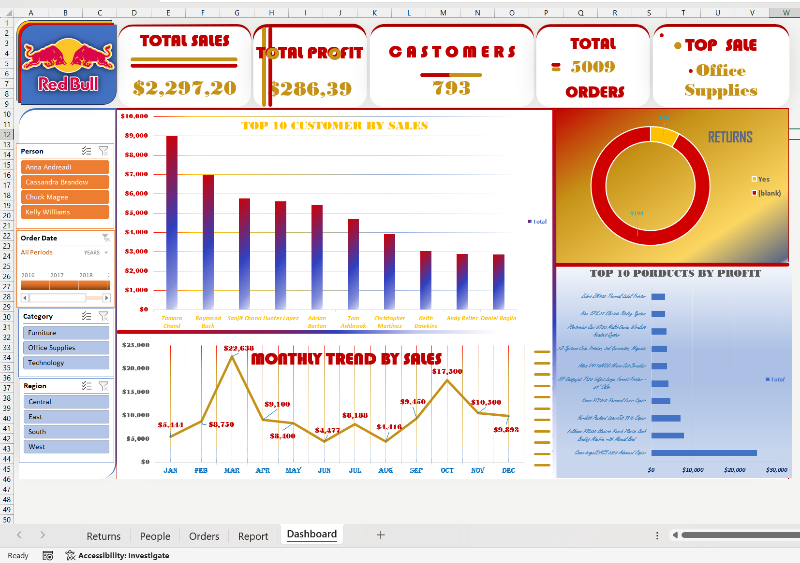
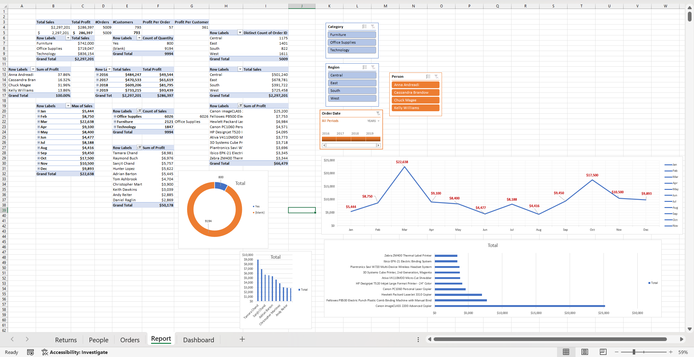

# Sales & Profit Analytics Dashboard (Excel)

An interactive Excel dashboard that turns four years of retail sales data (2016-2019) into clear answers: where the business makes profit, where it loses money, and what to do about it.

## The Problem
Sales were growing, but management could not tell which categories, regions, and products actually drove profit, or how discounts and returns affected the bottom line.

## The Solution
A single interactive dashboard with KPI cards, charts, and filters (Category, Region, Order Date timeline, and Regional Manager) built on Pivot Tables.

## Dataset
- Sample retail sales dataset, January 2016 to December 2019
- 9,994 order lines, 20 columns
- 5,009 orders, 793 customers, 1,862 products
- 3 categories, 17 sub-categories, 4 regions
- Returns table (296 orders) and regional managers table

## Key Findings
- Total sales: $2,297,201 | Total profit: $286,397 | Profit margin: 12.5%
- Sales grew 51% from 2016 to 2019, and profit rose from $49.5K to $93.4K
- Technology is the top category in both sales and profit
- Furniture sells almost as much as Office Supplies but with only a 2.5% margin
- Tables, Bookcases, and Supplies are loss-making sub-categories
- Every transaction with a discount of 30% or more lost money (about $135K in total)
- West is the strongest region; Central has the weakest margin (7.9%)
- Sales peak in September, November, and December
- 296 returned orders (5.9% of orders), worth about $180K in sales

## Recommendations
- Cap discounts below 30%
- Re-price or review the cost of Tables and Bookcases
- Focus marketing on the highest-margin categories and products
- Investigate the low profitability of the Central region
- Prepare inventory and campaigns ahead of the Q4 peak

## Dashboard Components
- KPI cards: total sales, total profit, customers, orders, top category
- Top 10 customers by profit
- Top 10 products by profit
- Monthly sales trend
- Returns breakdown
- Filters: Category, Region, Order Date, Regional Manager

## Tools
Microsoft Excel: Pivot Tables, Slicers, Timeline, Charts, Dashboard design

## Repository Contents
- Sales_Profit_Dashboard.xlsx: the full workbook (Orders, Returns, People, Report, Dashboard)
- screenshots/: dashboard and report previews
